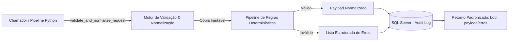

# 🛡️ Validador Determinístico e Auditoria de Payloads em Python

Módulo e serviço em **Python** projetado para atuar como **barreira de qualidade e governança** antes do envio de dados para serviços críticos ou modelos de inferência/IA. O código recebe requisições brutas, aplica regras de validação estritas sem conversão implícita de tipos, normaliza dados válidos de forma imutável e pode registrar a trilha de auditoria no **SQL Server** quando necessário.

---

##  Problema de Negócio Resolvido

Em ambientes corporativos e pipelines de dados/ML, sistemas externos frequentemente enviam requisições com campos ausentes, tipos inconsistentes (ex.: booleanos no lugar de números, valores infinitos, textos vazios) ou violações de regras de negócio. Quando esses dados chegam diretamente aos serviços finais:

* **Custos aumentam** com chamadas desnecessárias a APIs pagas ou modelos de inferência;
* **Falhas silenciosas** degradam a qualidade das respostas e relatórios;
* **Falta rastreabilidade** sobre *por que* e *quando* uma requisição foi rejeitada.

O **Inference Guard** resolve esse gargalo centralizando a validação determinística, o retorno explicável de erros e a auditoria em SQL Server em uma estrutura modular em Python.

---

##  Arquitetura e Fluxo de Execução



### Princípios de Engenharia Aplicados

* **Determinismo e Imutabilidade:** O motor de regras nunca altera (`muta`) o payload original recebido, não depende de estado global e não faz chamadas externas durante a validação.
* **Sem Coerção Implícita de Tipos:** Valores booleanos (`True`/`False`) não são aceitos como inteiros ou decimais, e strings não são convertidas silenciosamente para números.
* **Erros Explicáveis e Padronizados:** Toda rejeição retorna o caminho exato do campo (`field`), um código categorizado (`code`) e uma descrição clara (`message`).
* **Auditoria Opcional em SQL Server:** Quando persistência for necessária, registra `request_id`, status (`ACCEPTED` ou `REJECTED`), erros detectados e timestamp no SQL Server.

---

##  Stack Tecnológica

* **Linguagem:** Python 3.11+ (biblioteca padrão: `copy`, `math`, `dataclasses`, `typing`, `json`)
* **Banco de Dados (opcional para auditoria):** Microsoft SQL Server (`pyodbc` ou `pymssql`)
* **Testes:** `unittest` ou `pytest` (testes unitários de regras e integração com SQL Server)

---

##  Estrutura do Projeto


##  Regras de Negócio Implementadas

| Campo | Validação | Normalização | Códigos de Erro Possíveis |
| :--- | :--- | :--- | :--- |
| `request_id` | Presença opcional/preservada sem alteração | Mantido intacto | — |
| `features` | Obrigatório, objeto não nulo e não vazio | Cópia profunda imutável | `missing`, `null`, `invalid_type`, `empty` |
| `features.age` | Inteiro estrito (`int`, exceto `bool`) entre `0` e `120` | Mantido como `int` | `missing`, `null`, `invalid_type`, `out_of_range` |
| `features.year` | Inteiro estrito (`int`, exceto `bool`) | Mantido como `int` | `missing`, `null`, `invalid_type` |
| `features.income` | Numérico (`int` ou `float`, exceto `bool`), finito e `>= 0` | Zerado (`0` ou `0.0`) se `age < 16` | `missing`, `null`, `invalid_type`, `not_finite`, `out_of_range` |
| `features.country` | String não vazia após remoção de espaços | `.strip().upper()` (ex.: `" br "` → `"BR"`) | `missing`, `null`, `invalid_type`, `empty` |

---

##  Contrato da Função e Exemplos

### Assinatura Principal

`validate_and_normalize_request(request) -> tuple[bool, dict | list[dict]]`

### Exemplo de Requisição Válida

```python
request = {
    "request_id": "req-2026-001",
    "features": {
        "age": 14,
        "year": 2026,
        "income": 1500.50,
        "country": "  br  ",
    },
}
# Retorno:
# (
#     True,
#     {
#         "request_id": "req-2026-001",
#         "features": {
#             "age": 14,
#             "year": 2026,
#             "income": 0.0,
#             "country": "BR",
#         },
#     },
# )
```

### Exemplo de Requisição Inválida

```python
request = {
    "request_id": "req-2026-002",
    "features": {
        "age": 150,
        "year": "2026",
        "income": -50,
        "country": "   ",
    },
}
# Retorno:
# (
#     False,
#     [
#         {
#             "field": "features.age",
#             "code": "out_of_range",
#             "message": "O campo 'features.age' deve estar entre 0 e 120.",
#         },
#         {
#             "field": "features.year",
#             "code": "invalid_type",
#             "message": "O campo 'features.year' deve ser um inteiro.",
#         },
#         {
#             "field": "features.income",
#             "code": "out_of_range",
#             "message": "O campo 'features.income' deve ser maior ou igual a zero.",
#         },
#         {
#             "field": "features.country",
#             "code": "empty",
#             "message": "O campo 'features.country' não pode ser vazio.",
#         },
#     ],
# )
```


